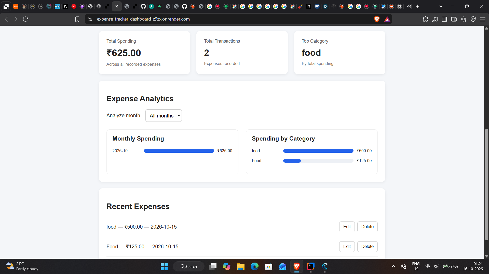

# Expense Tracker

A full-stack expense tracking application built with Python, FastAPI, JavaScript, and PostgreSQL. It allows users to record expenses, manage transactions, and view spending summaries through a dashboard.

**Live Demo:** [Expense Tracker Dashboard](https://expense-tracker-dashboard-z9zx.onrender.com/)

## Dashboard Preview


## Features

- **Expense management:** Add, view, edit, and delete expenses.
- **Expense categorization:** Organize expenses by category.
- **Dashboard analytics:** View total spending, number of expenses, and top spending category.
- **Monthly summaries:** Visualize expenses across different months.
- **Category analytics:** Compare spending across expense categories.
- **Month filtering:** Filter expenses by month.
- **Persistent storage:** Store expense records in a database.
- **REST API:** Access expense data through a FastAPI backend.
- **Responsive dashboard:** Access the application through a web browser.

## Tech Stack

| Technology | Purpose |
|---|---|
| Python | Application logic |
| FastAPI | Backend REST API |
| HTML | Dashboard structure |
| CSS | Dashboard styling |
| JavaScript | Frontend interactions and API requests |
| PostgreSQL | Production database |
| SQLite | Local development and testing |
| Psycopg | PostgreSQL connectivity |
| Pytest | Automated testing |
| Git and GitHub | Version control and source code hosting |
| Render | Frontend and backend deployment |
| Supabase | Hosted PostgreSQL database |

## Architecture

The application follows a simple client-server architecture.

```text
User
 |
 v
HTML / CSS / JavaScript Dashboard
 |
 | HTTP requests
 v
FastAPI Backend
 |
 | Database queries
 v
PostgreSQL (production)
SQLite (local development/tests)
```

The dashboard sends HTTP requests to the FastAPI backend. The backend validates requests and performs database operations. The resulting data is returned to the frontend as JSON and displayed in the dashboard.

## Live Application

- **Frontend:** [Open Dashboard](https://expense-tracker-dashboard-z9zx.onrender.com/)
- **Backend API:** [View Expenses API](https://expense-tracker-api-kg8k.onrender.com/expenses)
- **Interactive API Documentation:** [Open Swagger UI](https://expense-tracker-api-kg8k.onrender.com/docs)

## Project Structure

```text
SQL_EXPENSE_TRACKER/
├── api/
│   └── main.py
├── dashboard/
│   ├── index.html
│   ├── style.css
│   ├── script.js
│   └── favicon.svg
├── main.py
├── database.py
├── db_config.py
├── postgres_database.py
├── requirements.txt
├── test_expense_tracker.py
├── test_api.py
├── test_db_config.py
├── test_postgres_connection.py
├── .gitignore
└── README.md
```

*Note: This tree lists the expected project files; adjust it if your current repository differs.*

## Run Locally

### 1. Clone the repository

```bash
git clone <https://expense-tracker-dashboard-z9zx.onrender.com/>
cd SQL_EXPENSE_TRACKER
```

Replace the placeholder with your actual GitHub repository URL.

### 2. Create a virtual environment

```bash
python -m venv .venv
```

Activate it on Windows:

```powershell
.venv\Scripts\Activate.ps1
```

If PowerShell blocks activation, you can use Command Prompt instead:

```bat
.venv\Scripts\activate.bat
```

### 3. Install dependencies

```bash
pip install -r requirements.txt
```

### 4. Configure environment variables

Create a `.env` file in the project root for the database connection when using PostgreSQL.

```env
DATABASE_URL=your_postgresql_connection_string
```

Replace the placeholder with your own connection string. Never commit `.env` or expose database credentials in your repository.

When using SQLite locally, follow the database configuration implemented in the project.

### 5. Start the backend

From the project root, run:

```bash
uvicorn api.main:app --reload
